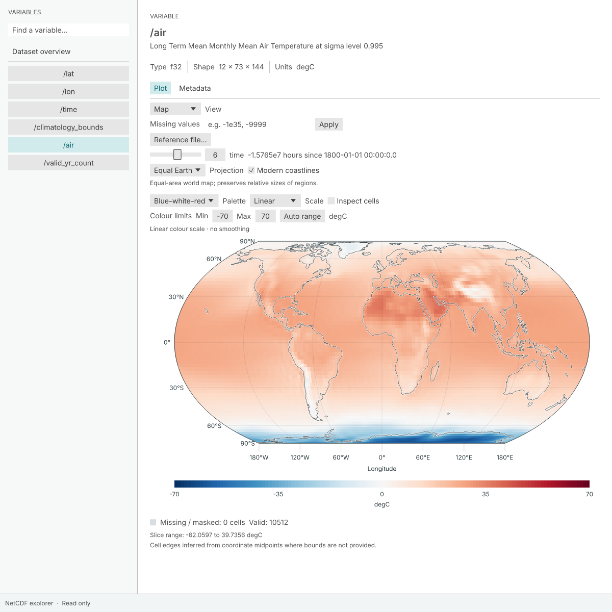

# NCDive

A lightweight NetCDF viewer, inspired by NASA Panoply.



*NCDive exploring NCEP temperature, with the variable browser and plot controls visible. [Exported figure](docs/images/ncdive-map.png) · [Data: NOAA PSL](https://psl.noaa.gov/thredds/dodsC/Datasets/ncep.reanalysis/Monthlies/surface/air.mon.ltm.nc.html).*

- Browse variables, dimensions, units and metadata in NetCDF classic and NetCDF-4 files.
- Explore maps and vertical sections, with time and depth selectors.
- Choose four map projections, colour palettes, log scales and optional coastlines.
- Compare matching grids and export figures as PNG or PDF.

Files are opened read-only.

## Run

Requires [Rust](https://rust-lang.org/tools/install/), the NetCDF C library and PROJ 9.6 or newer. With Rust installed, on macOS:

```sh
brew install netcdf proj pkg-config
cargo run --release -- samples/temperature.nc
```

Open your own file with **File → Open NetCDF file…**, or drag it into the window.

Tested on macOS; Windows and Linux builds are not yet verified.

[Full guide](docs/guide.md) · [Build and packaging](docs/guide.md#run) · [Development checks](docs/guide.md#check)
